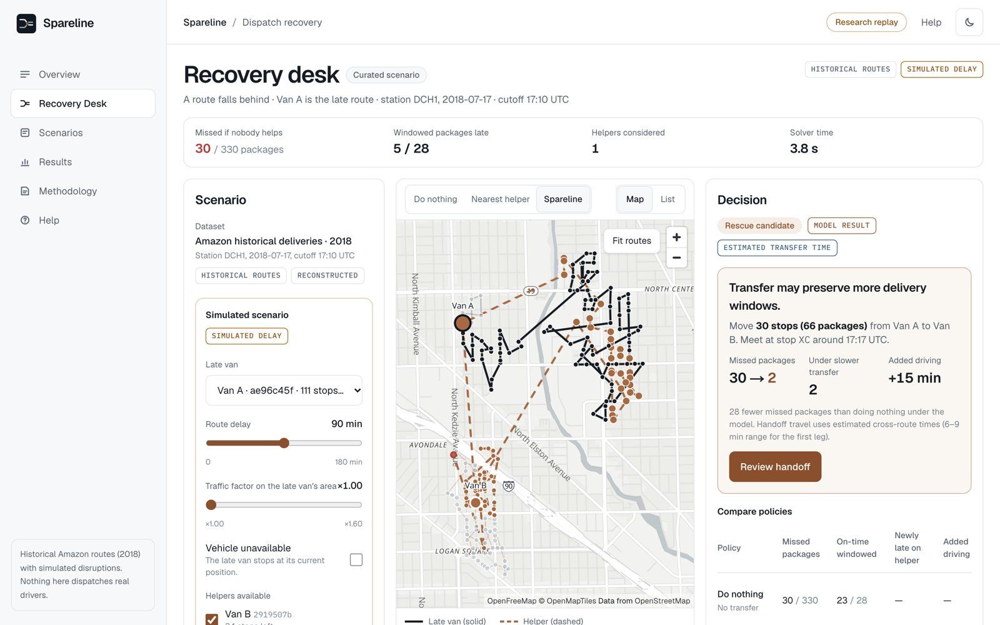
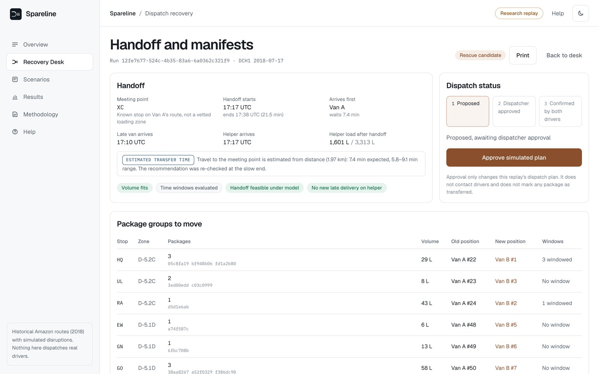
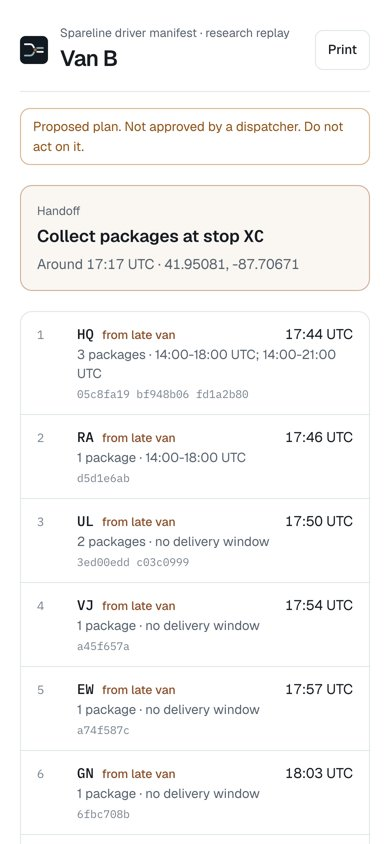
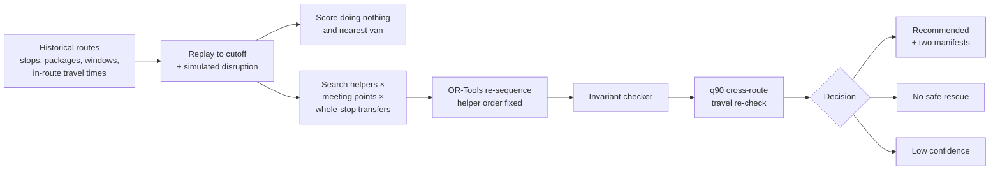

<div align="center">


# Spareline

**When a delivery route falls behind, know exactly what to move.**

[Live demo](https://spareline-steel.vercel.app) · [Results](evaluations/README.md) · [Methodology](https://spareline-steel.vercel.app/app/methodology) · [Pitch deck](artifacts/Spareline_DataNova_2026_Final.pdf)

[](https://github.com/winsznx/spareline/actions/workflows/ci.yml)


</div>

When one delivery van runs late, a dispatcher can ask another van to take some of its parcels. That only works if both vans can meet, the helper has room, and the helper doesn't miss its own deliveries as a result. Spareline works out which van should help, where they meet, which stops move and in what order. It compares that with doing nothing and with sending the nearest van. When no transfer is safe, it says so and why.

It runs on real 2018 delivery routes from the Amazon Last Mile Routing Research Challenge, with **simulated** disruptions. It's a research replay, not a live dispatch system, and nothing is sent to any driver.



## Try it in two minutes

Open the [live demo](https://spareline-steel.vercel.app), go to **Scenarios** and run each card. Every run calls the solver on the backend.

| Scenario | Depot, date | What happens |
|---|---|---|
| **A route falls behind** | DCH1, 2018-07-17 | Recommended. Missed packages: 30 doing nothing, 19 with the nearest van, 2 with Spareline. 30 stops move; the helper misses nothing new. Approve, confirm both drivers, download both manifests. |
| **A helper isn't really free** | DLA3, 2018-09-13 | No safe rescue. Every transfer that helps the late van makes the helper late (`HELPER_WOULD_BE_LATE`). |
| **No handoff helps** | DSE4, 2018-07-05 | Low confidence. A transfer helps under average travel estimates but not when cross-route travel is slow, so nothing is recommended. |

On the recovery desk you can change the delay, the slowdown, the failure toggle or which vans may help, then recalculate. Each change creates a new scenario revision and a fresh run.

<table>
<tr>
<td width="68%"></td>
<td></td>
</tr>
</table>

## Results

456 scenarios fixed before the run, on 114 held-out depot-day groups (evaluation `eval_20261110T185425Z_21dfd2fe`, config in [`evaluations/config.json`](evaluations/config.json)). Four disruptions per group: 75 and 105 minute delays, a 1.6× slowdown, a van failure.

| | Do nothing | Nearest van | Spareline |
|---|---:|---:|---:|
| Missed packages, all vans (of 195,279) | 24,474 | 24,889 | **23,593** |
| Same, cross-route travel at its slow (q90) estimate | | 25,145 | **23,713** |
| Windowed packages on time (of 13,894) | 12,165 | 12,090 | **12,200** |
| Helper packages newly missed | | 14 (129 at q90) | **0** |

- Spareline avoided 881 missed packages compared with doing nothing (mean 1.93 per scenario, 95% CI 1.47 to 2.43) and was never worse.
- It did worse than the nearest-van policy in 4 scenarios. Two of those hold even at slow travel, where Spareline's strict rules held back a transfer. Both are explained in [evaluations/README.md](evaluations/README.md).
- It recommended 74 rescues and held back in 280 of the 354 scenarios with missed packages.
- Solver time: mean 1.87 s, p95 3.65 s. Invariant violations in emitted plans: 0.

These are replay estimates under simulated disruptions, not field results.

## How it works



1. **Replay.** Each route is replayed in its observed stop order from its departure time, using that route's own historical travel times. At the cutoff every van has a position and a list of stops still to do.
2. **Disrupt.** A delay puts the late van X minutes behind plan. A slowdown multiplies travel inside its area. A failure stops the van.
3. **Score.** A package is missed if it would arrive after its delivery window or after the driver's shift limit (planned finish plus 60 minutes, a stated assumption).
4. **Search.** Try every other van, meeting points at either van's current position or next few stops, and groups of whole stops (route tails, at-risk stops, delivery zones). Screen by insertion, then re-sequence the best with OR-Tools. The helper's own stops keep their original order, so any gain comes from where the moved stops go.
5. **Check.** An independent checker confirms every package is assigned exactly once, the van never overfills, both vans are present before the handoff starts, and time only moves forward. The plan is then re-timed with every cross-route leg at its slow estimate. To be recommended it must still help, and the helper must not miss anything new.

Travel between stops of different routes isn't in the dataset, so it's estimated from distance. On 424,165 held-out pairs within routes, the estimate has a mean error of 59.9 s, and its 80% range covers the true time 81.1% of the time.

## What's in the repo

```
apps/web/            Next.js app: landing, overview, recovery desk, scenarios, manifests, driver view, results, methodology
services/api/        FastAPI service, solver, migrations and tests
  app/solver/        route model, travel estimator, schedule simulation, invariant checker, rescue search
  app/data/          dataset ingest and database seed
  scripts/           travel model fitting and the evaluation harness
packages/contracts/  API types shared with the web app
data/processed/      160 route groups (gzip), travel model, demo scenarios
evaluations/         predeclared config, per-scenario results, summary
deploy/              Dockerfile and Compose file for the API and Postgres
artifacts/           pitch deck (PPTX, PDF), Devpost text, screenshots
```

## Run locally

Requirements: Docker, Python 3.12 with [uv](https://docs.astral.sh/uv/), Node 20+ with pnpm.

```bash
# Postgres
docker run -d --name spareline-db -e POSTGRES_USER=spareline -e POSTGRES_PASSWORD=spareline \
  -e POSTGRES_DB=spareline -p 127.0.0.1:5544:5432 postgres:16-alpine

# API: migrate, seed the 160 groups and evaluation, serve on :8000
cd services/api
uv sync
uv run python -m app.data.seed
uv run uvicorn app.main:app --port 8000

# Web app on :3000 (talks to http://localhost:8000/v1 by default)
cd ../../apps/web
pnpm install
pnpm dev
```

API docs are at `http://localhost:8000/v1/docs`.

### Tests

```bash
cd services/api && uv run pytest                          # 34 tests: parsing, time zones, solver invariants, API flow, bad input
cd apps/web && BASE_URL=http://localhost:3000 pnpm test:e2e   # 24 browser tests at 1440, 1024, 768, 390 px
```

### Rebuild the data and evaluation from scratch

```bash
mkdir -p data/raw/almrrc2021 && cd data/raw/almrrc2021
B=https://amazon-last-mile-challenges.s3.amazonaws.com/almrrc2021/almrrc2021-data-evaluation
curl -O $B/model_apply_inputs/eval_route_data.json -O $B/model_apply_inputs/eval_package_data.json \
     -O $B/model_apply_inputs/eval_travel_times.json -O $B/model_score_inputs/eval_actual_sequences.json
cd ../../../services/api
uv run python -m app.data.ingest --raw ../../data/raw/almrrc2021 --out ../../data/processed/bundle.json --max-groups 160
uv run python -m scripts.fit_travel_model
uv run python -m scripts.evaluate --config ../../evaluations/config.json --workers 8
```

## Deployment

The web app is on Vercel. The API and its own Postgres run as an isolated Docker Compose project on a VPS (`deploy/compose.yml`). The browser calls `/api/v1/*` on the Vercel domain, which forwards to the API. CORS allows only the production origin, and every route is rate limited.

## Things we found in the data

- Only 7.1% of packages carry a delivery window, mostly 7 to 9 hours wide. Most missed packages in a disruption come from the shift limit, not windows.
- In 99.1% of stops with several packages, every package lists the same planned service time. Summing them would roughly triple stop times, so a stop's service time is the maximum.
- Stop IDs repeat across routes, so every stop is keyed by route and stop together.

## Limitations

- Historical 2018 routes with anonymized, perturbed coordinates. Disruptions are simulated.
- Van progress is reconstructed from average travel times, not GPS.
- Travel between routes is estimated and only checked against pairs within routes.
- The shift limit and handoff time (5 minutes plus 15 seconds per package) are assumptions.
- No dispatcher or driver has used it. The dataset licence doesn't allow commercial use.

## Licence and credits

Code: [MIT](LICENSE). Data and results derived from the Amazon Last Mile Routing Research Challenge: [CC BY-NC 4.0](DATA_LICENSE.md). Dataset paper: Merchán, D., et al. (2022), *2021 Amazon Last Mile Routing Research Challenge: Data Set*, Transportation Science. Optimization by [Google OR-Tools](https://developers.google.com/optimization). Map tiles from [OpenFreeMap](https://openfreemap.org), © OpenMapTiles, data © OpenStreetMap contributors.

Built for [DataNova 2026](https://datanova-2026-global-data-thon.devpost.com/), challenge DN-OR-01. See [CONTRIBUTING.md](CONTRIBUTING.md), [SECURITY.md](SECURITY.md) and [CITATION.cff](CITATION.cff).
